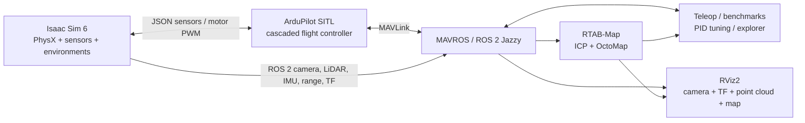

# Isaac Sim Autonomous Drone Stack

[](https://github.com/AjanM27/isaac-sim-drone-autonomy/actions/workflows/ci.yml)
[](https://ubuntu.com/)
[](https://docs.ros.org/en/jazzy/)
[](https://docs.isaacsim.omniverse.nvidia.com/6.0.0/)
[](LICENSE)

A reproducible research platform for autonomous quadrotor flight in NVIDIA
Isaac Sim. It connects a custom Iris vehicle to ArduPilot SITL through the JSON
physics interface, exposes MAVROS and ROS 2 topics, simulates RGB/IMU/ToF/3D
LiDAR sensors, runs RTAB-Map 3D SLAM, and performs collision-aware frontier
exploration in offline warehouse and hospital environments.

The repository includes the complete source, tuned flight-controller profile,
container definitions, RViz configuration, benchmark tools, autonomous PID
tuning pipeline, multi-drone experiments, and checksummed asset installer.
Generated logs, maps, videos, Docker layers, and third-party binary assets are
deliberately excluded from Git.

> [!IMPORTANT]
> The bootstrap installs the software stack, but it cannot turn unsupported
> hardware into an Isaac Sim workstation. You need Ubuntu 24.04 x86_64, a
> compatible NVIDIA RTX GPU/driver, at least 32 GB RAM, and roughly 70 GB free
> disk space. NVIDIA lists an RTX 4080/16 GB VRAM as the Isaac Sim 6 minimum.

## What is implemented

- Custom Iris rigid-body dynamics with four independently commanded motors.
- ArduPilot Copter 4.6.2 SITL, GUIDED flight, arming, takeoff, landing, and
  camera-relative velocity teleoperation.
- Tuned cascaded ArduPilot position, velocity, attitude, rate, altitude, yaw,
  and braking loops.
- Front RGB camera, IMU, upward/downward ToF and Ouster OS1 3D LiDAR.
- ROS 2 Jazzy bridge, MAVROS, TF tree, RViz dashboard and live telemetry.
- RTAB-Map point-to-plane ICP odometry and probabilistic 3D OctoMap output.
- Safe 3D frontier exploration with vehicle inflation, replanning, return-home,
  landing, and map persistence.
- Single-drone trajectory/SLAM benchmarks at 0.25, 0.5 and 1.0 m/s.
- Autonomous CMA-ES PID optimization and simultaneous multi-drone trials.
- Warehouse fleet demonstrations with up to ten drones in one physics scene.
- Offline repeat launches after the initial dependency and asset download.

## Architecture



Isaac Sim runs natively for direct RTX access. ArduPilot, MAVROS and RTAB-Map
run in reproducible Docker containers using host networking. No host ROS
installation is needed for flight control; the setup script installs ROS 2
Jazzy desktop only to provide the local RViz window and command-line tools.

## Start from a clean Ubuntu 24.04 installation

```bash
sudo apt update && sudo apt install -y git
git clone https://github.com/AjanM27/isaac-sim-drone-autonomy.git
cd isaac-sim-drone-autonomy
./scripts/setup_ubuntu.sh --accept-eula
```

`--accept-eula` records that you reviewed and accepted the
[NVIDIA Omniverse EULA](https://docs.omniverse.nvidia.com/platform/latest/common/NVIDIA_Omniverse_License_Agreement.html).
The idempotent setup command installs Docker Engine/Compose, ROS 2 Jazzy and
RViz, a dedicated Isaac Sim 6.0 Python environment, all checksummed simulation
assets, and the three project container images. It can be safely rerun.

If no working NVIDIA driver is present, setup tells you to run
`sudo ubuntu-drivers install`, reboot, and rerun the same command. If Docker
group membership was just added, log out and back in once. These are the only
machine-level interruptions; completed downloads remain cached.

Validate the installation:

```bash
./scripts/doctor.sh
```

See [Installation](docs/INSTALLATION.md) for disk/network requirements,
existing Isaac Sim installations, minimal asset setup, and offline transfer.

## Launch and fly

Start the complete warehouse stack:

```bash
./simulation/room_quadcopter/run_room_ardupilot.sh
```

Isaac Sim and the preconfigured RViz window open automatically. Once the scene
is running, open a second terminal:

```bash
cd isaac-sim-drone-autonomy
bash docker/flight_control/teleop.sh
```

The teleoperator arms, takes off to about 1.5 m and then accepts:

| Key | Action |
|---|---|
| `W` / `S` | forward / backward relative to the front camera |
| `A` / `D` | left / right relative to the front camera |
| `R` / `F` | up / down |
| `1` … `5` | select speed profile |
| `-` / `+` | decrease / increase speed |
| `Space` | brake, then lock the stopped position |
| `Q` | land and exit |

Stop all companion containers:

```bash
bash docker/flight_control/stop.sh
```

## Hospital mapping and autonomous exploration

The setup command downloads the complete Hospital asset tree and verifies its
USD, MDL and texture dependencies. Normal launches then work without internet.

```bash
# Manual flight, 3D LiDAR SLAM and RViz
./simulation/room_quadcopter/run_hospital_demo.sh

# Autonomous collision-aware 3D frontier exploration
./simulation/room_quadcopter/run_hospital_exploration.sh

# Reopen the latest saved occupancy map
./simulation/room_quadcopter/view_voxel_map.sh
```

RTAB-Map's 15 cm probabilistic OctoMap is the canonical global/shareable map.
The explorer keeps a separate 30 cm sparse occupancy cache for inexpensive
local frontier and A* planning. Every run stores telemetry, summary metrics,
the compressed OctoMap, local planning map and RTAB-Map database under
`simulation/room_quadcopter/results/`.

## Other validated workflows

```bash
# Flight-stack health check
bash docker/flight_control/test_flight_control.sh

# ROS bridge and 3D LiDAR checks
bash docker/ros2/check_bridge.sh
bash docker/flight_control/check_3d_lidar.sh

# Repeatable 0.25/0.5/1.0 m/s flight + SLAM benchmark
bash docker/flight_control/run_checkpoint1.sh

# Nine-drone visible warehouse demonstration
./simulation/room_quadcopter/run_warehouse_fleet.sh 9
bash docker/flight_control/fleet_teleop.sh 1

# Autonomous multi-drone PID optimization
bash docker/flight_control/start_autonomous_pid_tuning.sh
bash docker/flight_control/status_autonomous_pid_tuning.sh --watch
```

The complete command catalogue, outputs and environment variables are in
[Usage](docs/USAGE.md). Controller methodology is documented in
[PID tuning](docker/flight_control/PID_TUNING.md), and the moving-flight SLAM
evaluation is documented in [Checkpoint 1](simulation/room_quadcopter/CHECKPOINT1.md).

## Repository layout

```text
docker/
  flight_control/     ArduPilot, MAVROS, teleop, tuning and benchmarks
  slam/               RTAB-Map ROS 2 package and container
  ros2/               Minimal bridge-debug container
simulation/room_quadcopter/
  scripts/            Isaac stage, sensors, dynamics and asset tooling
  rviz/               Ready-to-use visualization configuration
  asset_manifest.json Checksummed NVIDIA asset download manifest
  results/             Generated runtime output (ignored)
scripts/
  setup_ubuntu.sh      Full machine bootstrap
  doctor.sh            Installation and runtime diagnostics
  download_assets.py  Resumable verified offline-asset installer
docs/                  Installation, architecture, use and troubleshooting
```

## Reproducibility and safety

- Container bases and ArduPilot are version-pinned.
- Downloaded assets are SHA-256 verified against the versioned manifest.
- Isaac Sim uses a dedicated virtual environment and never modifies the
  system Python environment.
- Normal launches use `--no-build` and project-local assets, so they do not
  contact package registries or asset servers.
- Exploration inflates obstacles by the Iris footprint and enforces upward and
  downward ToF clearance, but this is research software—not a certified
  collision-avoidance or flight-safety system.

## Documentation

- [Installation and clean-machine setup](docs/INSTALLATION.md)
- [Launch modes and command reference](docs/USAGE.md)
- [System architecture and data flow](docs/ARCHITECTURE.md)
- [Troubleshooting](docs/TROUBLESHOOTING.md)
- [Contributing](CONTRIBUTING.md)
- [Third-party software and assets](THIRD_PARTY_NOTICES.md)

## License and attribution

Project code is licensed under [Apache-2.0](LICENSE). NVIDIA Isaac Sim,
downloaded NVIDIA assets, the CC BY 4.0 Hospital environment, ArduPilot,
ROS/MAVROS and RTAB-Map retain their respective licenses. See
[Third-party notices](THIRD_PARTY_NOTICES.md). This project is independent and
is not endorsed by NVIDIA, ArduPilot, Open Robotics or RTAB-Map.
